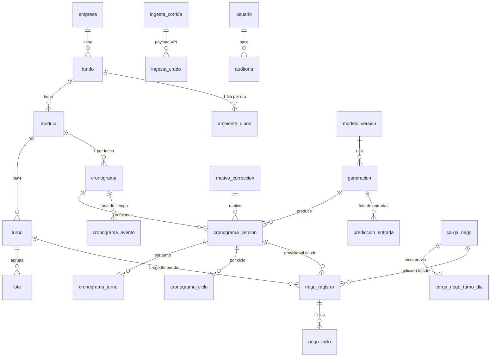
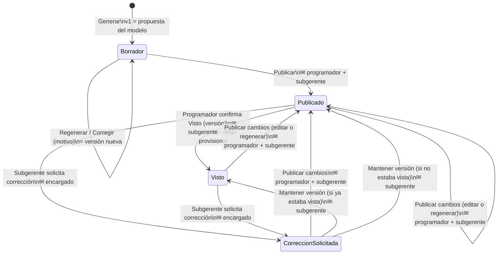

# Propuesta – Sistema de Plan de Riego (MVP)

Grupo El Rocío · AvoPeru y Talsa · fundo ENSUEÑO 1 · módulo EN01-MOD5 (TE01–TE05)

Documento para revisión antes de implementar (paso 1 de la forma de trabajo). Incluye lo encontrado al
explorar el repositorio, el modelo de datos, las reglas del flujo, la máquina de estados, los endpoints,
la propuesta visual, el plan por fases y las decisiones que necesitan tu OK. Pasó por una revisión
adversarial (cobertura del pedido, integración con `riego_ml`, flujos y seguridad) cuyos hallazgos ya
están incorporados.

Maqueta visual (paleta y pantallas): https://claude.ai/artifact/H7ZnQ5aEsLTzK5pFeCfPbK

---

## 0. Hallazgos de la exploración que condicionan el diseño

| # | Hallazgo | Consecuencia en el diseño |
|---|---|---|
| H1 | `Historial` solo necesita **dos fuentes**: ciclos de riego (14 columnas `COLUMNAS_RIEGO`) y `ambiente_diario` (Fundo, Fecha, las 38 columnas de `unir.columnas_ambiente()` y `tiene_meteo/suelo/planta` = 43). Armarlo en memoria da **la misma predicción** que la ruta por archivos. | La BD guarda riego por ciclo y una tabla derivada `ambiente_diario`. El backend arma `Historial(ciclos, tabla_turno_dia(ciclos), ambiente, …)` con `limpiar_ciclos(…, 5.0, 2.0)`. Test de paridad **ida y vuelta** (cargar a la BD → leer → planificar) contra la ruta por archivos. |
| H2 | `planificar` es **determinista**. ~0,6 s por día; cargar el modelo ~2 s; usa todos los núcleos (`n_jobs=-1`). | Modelo cargado una vez al iniciar; una predicción a la vez. "Regenerar con los mismos datos" da lo mismo y se avisa "sin cambios". |
| H3 | La salida **no trae el factor de caudal** (min por m3/ha). Duración = m3/ha × factor (mediana 30 días del turno, cambia día a día; respaldo histórico). Área por turno fija (TE01 13,019 · TE02 12,649 · TE03 12,423 · TE04 12,459 · TE05 12,2792 ha). | Por día y turno se guarda `factor_min_por_m3ha` (sin redondear, obtenido con `plan.factor_duracion(features)`), `area_ha` y `caudal_m3h = area×60/factor`. Con eso la edición recalcula igual que el modelo. |
| H4 | El modelo de `n_ciclos` elegido (`persistencia_segura`, umbral 1,01) **nunca cambia el n° de ayer**; solo usa LightGBM si el turno no regó ayer. | La UI muestra "igual a ayer"; quien cambia el n° es el encargado. Para que el cambio sea coherente, al generar se guarda también la salida del modelo **para cada n = 1..5** (ver §3.4). No se toca el modelo. |
| H5 | Para varios días `planificar` es recursivo, **no extiende el ambiente** (clima/Phytech de "ayer" vacíos del día 2 en adelante) y **borra** el riego que exista en las fechas planificadas. Faltar datos no detiene la predicción. | Días 2..N marcados *preliminar*. El bucle de generación respeta los días que no se regeneran (§3.1). |
| H6 | `_avisar_datos_faltantes` solo escribe en el log y mira la fecha máxima de cada fuente (hasta D-1, sin tolerancia). | Se reimplementa como función que devuelve verde/naranja por fuente, calculada en la BD **por turno** para el riego y detectando huecos (§3.3). |
| H7 | WeatherLink v2: `api-key` en la query + header `X-Api-Secret`, máx. 24 h por llamada, timestamp de **fin** de intervalo, unidades imperiales. Cotejado con 13 231 registros de `data_metereologica.xlsx`: `T° Prom` = `T° Máx` = **`temp_out_hi`**, `T° Mín` = `temp_out_lo`, `%HR` = `hum_out`, `Rad` = `solar_rad_hi`, `ETO` = `et`×25,4, `Viento` = `wind_run`×1,609 (km por 30 min), `Lluvia` = `rainfall_mm`, `DPV` = Tetens con `temp_out` redondeado a 0,1 °C. | Adaptador WeatherLink → formato `meteo.py` con esas fórmulas (95–100 % de coincidencia) y test con muestras reales. El registro de las 00:00 pertenece al día **nuevo** (igual que el Excel). |
| H8 | Phytech: JWT con `X-API-KEY`/`X-API-SECRET-KEY` (24 h), suelo máx. 7 días por llamada (devuelve las 24 h con `null`), NDVI en ZIP (se usan los histogramas), pronóstico **sin historia**. | Cliente con reintentos (429/5xx/401) portado de `descargar_phytech.py`. Una hora de suelo cuenta como dato solo si trae alguna humedad. El pronóstico se guarda con su fecha de captura. |
| H9 | `leer_meteo`, `leer_phytech`, `leer_ndvi` mezclan la lectura del archivo con el saneamiento. `limpiar_suelo`, `limpiar_planta`, `meteo_diaria`, `construir_ambiente_diario`, `limpiar_ciclos`, `tabla_turno_dia` ya aceptan DataFrames; `leer_riego` acepta `BytesIO`. | Ver **decisión D1**. |
| H10 | **Ni el modelo (`.joblib`) ni los datos (`ml/data`) están en git**; `riego_ml` no es instalable (usa `sys.path`); `joblib.load` ejecuta código (pickle). | La carga inicial se corre en una máquina con `ml/data/raw`. En el servidor el modelo llega por `ML_MODEL_PATH` y se verifica su sha256. Ver **D2**. |
| H11 | Hoy: riego hasta 04/11 (sin 31/10 y 01/11), meteorología hasta 01/11, Phytech hasta 29/10. | El panel de frescura arranca en naranja hasta la primera ingesta. |
| H12 | Supabase pooler **6543 = modo transacción**: sin *prepared statements* ni estado de sesión (`SET`, `pg_advisory_lock` no sirven entre transacciones). | psycopg con `prepare_threshold=None` y `NullPool`; esquema explícito en cada tabla (sin `search_path`); exclusión entre procesos con filas en BD, no con candados de sesión (§8). Migraciones por 5432. |
| H13 | Hoja `siga`: 5 turnos, 21 lotes, válvula del controlador (7 dígitos, 6061000) y SIGA (8 dígitos, 60610002), empresa **AVO PERÚ S.A.C.**, PALTA HASS, campaña 2026-2027. Sin caudal. | Semillas fijadas en la migración (el Excel no está en git). |
| H14 | MOD5: 59 duplicados exactos, 40 filas con 0 m3, 145 con fin > 24 h (`1900-01-01 HH:MM`), `fecha` con hora en las filas recientes. Es un archivo **acumulado** (abr-2021 a nov-2026). | El cargador reutiliza `leer_riego` + `limpiar_ciclos` y compara por turno-día con hash de contenido: subir el archivo completo otra vez no crea versiones. |

---

## 1. Arquitectura

```text
React PWA ──HTTPS──► FastAPI (1 worker)                                         Supabase Postgres
(Vite, TS)            api/v1/endpoints → services → repositories (SQLAlchemy 2) ──► esquema `riego` (RLS, sin Data API)
                      ml/  model_loader (PlanRiego 1 vez) · historial_bd (BD → Historial)
                      integraciones/ weatherlink · phytech · smtp · controlador (solo interfaz)
                      riego_ml (ml/src) importado sin cambios de lógica
                 ┌──► proceso de tareas (python -m app.jobs): ingesta 05:00 Lima · cola de correos
```

- **Backend**: FastAPI + SQLAlchemy 2 (sync, psycopg 3) + Alembic + Pydantic v2. Endpoints delgados;
  reglas y permisos en `services/`; acceso a datos en `repositories/`. Mismo venv Python 3.11.9 con las
  versiones fijas de `ml/requirements.txt` (`backend/requirements.txt` empieza con `-r ../ml/requirements.txt`).
- **Procesos**: la API corre con **1 worker** de uvicorn (el modelo usa todos los núcleos). Las tareas
  programadas y el envío de correos corren en un proceso aparte (`python -m app.jobs`, o dentro de la API
  con `SCHEDULER_ENABLED=true` en desarrollo). Ver §8.
- **Zona horaria**: instantes de sistema en `timestamptz`; **lecturas de sensores en hora local de Lima
  sin zona** (`timestamp`), igual que `riego_ml` (corta el día con `normalize()` y el cierre del suelo con
  las horas 21–23). Fechas agronómicas `date` + minutos desde las 00:00. Toda "fecha de hoy" sale de un
  único helper `hoy_lima()`; prohibido `date.today()` o `CURRENT_DATE`.
- **Supabase**: todo con Alembic en el esquema `riego` (la Data API solo publica `public`), incluida la
  tabla `alembic_version`; RLS en todas las tablas sin políticas; `REVOKE` y `ALTER DEFAULT PRIVILEGES`
  para `anon`, `authenticated` y `PUBLIC`. La app usa un rol propio `riego_app` (no dueño). El frontend
  no conoce nada de Supabase.

---

## 2. Modelo de datos

Convenciones: esquema `riego`, `id bigint identity`, `created_at timestamptz default now()`, nombres en
español `snake_case`, enums de Postgres para estados, claves foráneas con índice, valores numéricos de
sensores y modelo en `double precision`.

### 2.1 Diagrama (resumen)



### 2.2 Tablas

**Organización (semillas)**

| Tabla | Columnas principales | Restricciones |
|---|---|---|
| `empresa` | codigo, nombre, activo | `uq(codigo)` — AVOPERU, TALSA |
| `fundo` | empresa_id, codigo, nombre (`ENSUEÑO 1`, Unicode NFC), zona (CHAO), activo | `uq(nombre)`, `uq(codigo)` |
| `modulo` | fundo_id, codigo (`EN01-MOD5`), nombre, area_ha (62,8292), cultivo, variedad, campana, activo | `uq(codigo)` |
| `turno` | modulo_id, codigo (TE01…), orden, area_ha, valvula_controlador (6061000…), valvula_siga (60610002…), activo | `uq(modulo_id, codigo)`, `uq(valvula_controlador)` |
| `lote` | turno_id, codigo (E001…E021), area_ha, campana | `uq(turno_id, codigo, campana)` |

Los IDs externos (estación WeatherLink, área/plot/project de Phytech) vienen **solo del `.env`**
(`WEATHERLINK_STATION_ID`, `PHYTECH_*_ID`), no de una tabla, para no tener dos fuentes de verdad. Los
datos se asocian al fundo ENSUEÑO 1.

**Usuarios y seguridad**

| Tabla | Columnas principales | Notas |
|---|---|---|
| `usuario` | username, nombre, correo, password_hash (argon2id), rol (`admin`/`encargado`/`programador`/`subgerente`), activo, **token_version**, debe_cambiar_password, ultimo_acceso_at, password_cambiada_at, creado_por | `uq(lower(username))`, `uq(lower(correo))` |
| `sesion_refresh` | usuario_id, token_hash, familia, expira_at, revocado_at, reemplazado_por, reemplazado_at, ip, user_agent | Rotación con detección de reuso y 30 s de gracia (dos pestañas) |
| `password_reset` | usuario_id, token_hash (SHA-256), expira_at (30 min), usado_at, ip | Un solo uso; al crear uno se invalidan los anteriores |
| `intento_login` | tipo (`login`/`recuperar`/`restablecer`), username_intentado, ip, exito, created_at | Contadores de límite de intentos (§7) |
| `auditoria` | ocurrido_at, usuario_id, username, rol, accion, entidad, entidad_id, detalle jsonb (antes/después, lista blanca de campos), ip, user_agent | El rol de la app solo tiene SELECT/INSERT; triggers rechazan UPDATE, DELETE y TRUNCATE. Índices por fecha, usuario, acción y entidad |
| `notificacion_correo` | tipo, cronograma_id, rol_destino, destinatarios (se resuelven al enviar), asunto, contexto jsonb **sin secretos**, estado (`pendiente`/`enviando`/`enviado`/`error`/`sin_destinatarios`), intentos, proximo_intento_at, bloqueado_hasta, ultimo_error, enviado_at | Cola + registro de envíos |

**Datos de campo (crudo + limpio)**

| Tabla | Granularidad | Clave única | Contenido |
|---|---|---|---|
| `ingesta_corrida` | 1 por ejecución | `uq(fuente, fecha_programada)` para las programadas | fuente, disparo (`programado`/`manual`/`script`), usuario, desde/hasta, inicio/fin, duración, estado (`en_curso`/`ok`/`parcial`/`error`), filas nuevas/actualizadas/omitidas/conflictos, errores jsonb (`{tipo, status_code, endpoint sin query, mensaje redactado}`) |
| `ingesta_crudo` | 1 por llamada a API | — | corrida_id, endpoint, parámetros **de negocio** (sin claves), payload jsonb tal cual |
| `meteo_lectura` | 30 min | `(fundo_id, fecha_hora)` | `fecha_hora` = hora local de Lima del fin de intervalo; T, T_max, T_min, HR, HR_max, Rad, ETo, DPV, Viento, Lluvia en las unidades de `meteo.py`; origen (`excel_historico`/`weatherlink`). WeatherLink **no pisa** lecturas del Excel histórico |
| `phytech_suelo_horario` | hora | `(project_id, fecha_hora)` | Salida de `limpiar_suelo`: hum 15–90 cm, temp 15/30/60/90 cm, zona radicular, saturación, línea de estrés, `hay_dato` |
| `phytech_planta_diario` | día | `(project_id, fecha)` | MDS, crecimiento de tronco, índice de estrés (ps), fruto, ET y lluvia de Phytech |
| `ndvi_imagen` | imagen (~10 días) | `image_id` | plot, fecha, no_vegetation, clases jsonb, ndvi_medio |
| `pronostico_clima` | captura × día | `(project_id, capturado_fecha, fecha)` | T máx, ETo, ETc, humedad de los próximos días |
| `ambiente_diario` | fundo × día | `(fundo_id, fecha)` | **Tabla derivada**: las 38 columnas de `columnas_ambiente()` + `tiene_meteo/suelo/planta`. Solo días cerrados (< hoy). Se recalcula por día afectado (§3.6). Un test compara el esquema con `columnas_ambiente()` |

**Riego aplicado** (unidad = turno × día; versiones conservadas)

| Tabla | Columnas principales | Restricciones |
|---|---|---|
| `riego_registro` | modulo_id, turno_id, fecha, version, **vigente**, estado (`provisional`/`aplicado`), origen (`historico`/`cronograma`/`excel`/`manual`/`controlador`), **sin_riego** (registro con 0 ciclos = "no se regó"), contenido_sha256, cronograma_version_id, carga_id, basado_en_id, motivo, comentario, creado_por | `uq(turno_id, fecha, version)`; índice único parcial `(turno_id, fecha) WHERE vigente` |
| `riego_ciclo` | registro_id, inicio_min, fin_min, duracion_min, riego_m3, riego_m3ha, area_ha, valvula, hora_inicio, hora_fin, fin_dia_siguiente | `uq(registro_id, inicio_min)` |
| `carga_riego` | archivo_nombre (saneado), sha256, tamaño, subido_por/at, estado (`previsualizada`/`confirmada`/`descartada`/`vencida`), resumen jsonb, confirmado_por/at | Vence a las 24 h o si cambió algún registro comparado |
| `carga_riego_turno_dia` | carga_id, fecha, turno_id, resultado (`nuevo`/`igual`/`reemplaza_provisional`/`reemplaza_aplicado`/`sin_riego`/`error`), vigente_id_comparado, ciclos jsonb, mensajes, aplicar (bool, editable en la vista previa) | — |

Editar crea una versión nueva (la anterior queda `vigente=false`, nunca se borra). Un turno-día
**aplicado** ya no vuelve a provisional. El origen `controlador` es el punto de extensión (interfaz
`FuenteRiegoControlador` sin implementación: Talgil/Redshift).

**Cronogramas y modelo**

| Tabla | Columnas principales | Restricciones |
|---|---|---|
| `modelo_version` | version (`2026-11-07_1115`), sha256, metadata jsonb, ruta, registrado_at | `uq(version)`; se registra al iniciar (`ON CONFLICT DO NOTHING`) |
| `generacion` | modulo_id, fecha_inicio, dias, tipo (`generar`/`regenerar`), usuario_id, modelo_version_id, frescura jsonb, resultado_por_dia jsonb, duracion_ms | Agrupa lo creado en un "Generar" |
| `cronograma` | modulo_id, fecha, estado, **version_publicada_id**, **borrador_version_id**, **visto_version_id**, visto_programador_at/por, num_publicaciones, correccion_solicitada_at/por/motivo, lock_version | **`uq(modulo_id, fecha)`** = un cronograma por fecha y módulo |
| `cronograma_version` | cronograma_id, numero, origen (`modelo`/`regenerado`/`correccion`/`edicion`), generacion_id, modelo_version_id, basada_en_id, motivo_codigo, motivo_comentario, preliminar, datos_incompletos, creado_por, publicada_at/por | `uq(cronograma_id, numero)`; **inmutable** (solo se fija `publicada_at/por` una vez) |
| `cronograma_turno` | version_id, turno_id, n_ciclos, n_ciclos_modelo, factor_min_por_m3ha, area_ha, caudal_m3h | `uq(version_id, turno_id)` |
| `cronograma_ciclo` | version_id, turno_id, ciclo, riego_m3ha, riego_m3, duracion_min, inicio_min (puede ser ≥ 1440), fin_min, hora_inicio, hora_fin, fin_dia_siguiente, m3ha_p10/p90, duracion_p10/p90, inicio_desde/hasta, ciclo_modelo, duracion_manual, campos_editados | `uq(version_id, turno_id, ciclo)` |
| `prediccion_entrada` | generacion_id, fecha, turno_id, modelo_version_id, features_turno jsonb (todas las columnas de `features_para_fechas`, incluidas las excluidas del modelo), features_ciclo jsonb (por ciclo, con `ciclo_modelo` y ciclo final), alternativas_n jsonb (salida del modelo para n = 1..5), origen_riego_d1 (`aplicado`/`provisional`/`cronograma`/`ninguno`), fuentes_hasta jsonb | `uq(generacion_id, fecha, turno_id)` — la "foto" |
| `cronograma_evento` | cronograma_id, version_id, tipo, usuario_id, ocurrido_at, motivo_codigo, comentario, detalle jsonb | Línea de tiempo (tipos en §5) |
| `motivo_correccion` | codigo, nombre, orden, activo | Semillas: `clima_lluvia`, `criterio_agronomico`, `programa_semanal`, `falla_equipo`, `operacion_personal`, `otro` |

**Bases de comparación**: *propuesta original* = versión 1 (`origen=modelo`, inmutable). *Base del
modelo* = la última versión `modelo`/`regenerado` sobre la que se construyó la versión actual (se recorre
`basada_en_id`); es la base por defecto de las diferencias y del resaltado.

### 2.3 Cómo se arma el `Historial` desde la BD

1. **Riego por turno-día**: se toma el `riego_registro` vigente (aplicado > provisional); un registro
   `sin_riego` cuenta como dato (el turno no regó). Si un turno-día anterior a la fecha a planificar **no
   tiene registro**, se usan los ciclos de ese turno en la versión de referencia del cronograma de ese día
   (publicada; si no hay, el borrador) y el día planificado queda *preliminar*.
2. Se arma el DataFrame con `COLUMNAS_RIEGO`; `Fecha` como `datetime64`, textos como `str` NFC (el texto
   de `Fundo` debe coincidir con el de `ambiente`, o las variables de clima quedan vacías sin aviso).
3. `limpiar_ciclos(ciclos, 5.0, 2.0)` → `tabla_turno_dia` → `ambiente_diario` desde la tabla (fechas como
   `datetime64`) → `Historial(...)`. Se carga toda la historia (≈21 mil ciclos, < 1 s).

### 2.4 Exportación para refinamiento (solo admin)

CSV con el formato de `ml/data/processed/ciclos.csv` (claves, ciclo y todas las variables de la foto),
una fila por cronograma × turno × ciclo, con bloques `modelo_v1_*` (propuesta original), `modelo_base_*`,
`final_*` (última versión publicada) y `aplicado_*` (riego vigente, con `estado_riego`), más
`motivos` (lista ordenada de las correcciones posteriores a la base), `ultimo_motivo`,
`n_correcciones`, `preliminar`, `datos_incompletos`, `regenerado`, `num_versiones`, `modelo_version`. Los
textos libres se escapan contra inyección de fórmulas.

---

## 3. Reglas del flujo

### 3.1 Generar (encargado, admin)

- **Entrada**: módulo, fecha inicial (por defecto **hoy** en Lima, después de la ingesta de las 05:00) y
  n° de días (por defecto 3). Se valida fecha inicial entre hoy − 7 y hoy + 1, y ≥ 45 días de riego
  antes; si no, error con mensaje en español. Si la fecha inicial es mañana, el día 1 también queda
  *preliminar* ("el día anterior aún no terminó").
- **Por cada día de la ventana**:
  - sin cronograma → se crea en Borrador con v1 `origen=modelo`;
  - Borrador sin correcciones → nueva versión `regenerado`;
  - Borrador con correcciones, o Publicado / Visto / Corrección solicitada → **no se toca** (se informa
    "existe; use Regenerar en el detalle"), salvo que el usuario marque "regenerar también estos", y en
    ese caso queda como borrador de cambios (§3.2).
- **Bucle**: mismo procedimiento que `planificar` (features del día → `plan.predecir` → agregar al
  historial), pero para los días que no se tocan se agrega al historial su riego vigente o su versión de
  referencia en lugar de la predicción. Así cada día siguiente se calcula sobre lo que realmente quedó.
  Un test verifica igualdad exacta con `planificar` cuando todos los días son nuevos.
- La respuesta devuelve por día la acción (creado / regenerado / omitido), las marcas y la frescura.
- Generar y Regenerar se serializan por módulo en la BD (`SELECT … FOR UPDATE` sobre los cronogramas del
  rango después de tomar el candado del modelo); un conflicto responde 409, no 500.

### 3.2 Estados y transiciones

Estados (enum): **Borrador**, **Publicado**, **Visto**, **Corrección solicitada**. Además, un cronograma
publicado puede tener un *borrador de cambios* abierto (`borrador_version_id`), que el programador no ve.



| Acción | Quién | Desde | Resultado | Correo | Evento |
|---|---|---|---|---|---|
| Regenerar | A, E | Borrador; o Publicado/Visto/Corrección solicitada (abre o amplía el borrador de cambios) | Versión `regenerado` con su foto; si había correcciones en el borrador pide confirmación | — | `regenerado` |
| Corregir / editar | A, E | Borrador o borrador de cambios | Cada guardado crea una versión inmutable `correccion`/`edicion`; motivo obligatorio si cambia algo respecto de su base | — | `corregido` |
| Descartar borrador de cambios | A, E | con borrador abierto | `borrador_version_id = null`; versiones conservadas; estado sin cambio | — | `borrador_descartado` |
| Publicar | A, E | Borrador | Publicado; `num_publicaciones = 1` | P + S | `publicado` |
| Publicar cambios | A, E | Publicado / Visto / Corrección solicitada con borrador | Publicado; se limpia `visto_*`; si había solicitud, queda atendida; actualiza el riego provisional de origen cronograma (§3.5) | P + S ("se modificó", con resumen de cambios) | `modificado`, `correccion_atendida` |
| Confirmar Visto | P (y A) | Publicado | Recibe `version_id`; 409 si hay una publicada más nueva. Visto; crea/actualiza riego provisional | S | `visto_programador` |
| Abrir detalle | P, S | cualquiera visible | `POST /cronogramas/{id}/vista` al montar la pantalla (máx. 1 cada 30 min por usuario y versión en la línea de tiempo; toda vista va a auditoría) | — | `visto_subgerente` / `abierto_programador` |
| Solicitar corrección | S (y A) | Publicado, Visto | Recibe `version_id` + motivo; conserva el borrador si había | E | `correccion_solicitada` |
| Mantener versión publicada | A, E | Corrección solicitada | Comentario obligatorio; vuelve a Visto o Publicado según `visto_version_id` | S | `correccion_mantenida` |
| Exportar PDF/Excel | todos (según visibilidad) | cualquiera visible | El programador siempre exporta la versión publicada | — | `exportado` |

- **Días pasados** (fecha < hoy): publicar cambios no pide nuevo Visto ni avisa al programador (solo al
  subgerente, marcado "corrección retrospectiva"); Visto ya no se ofrece.
- **Visibilidad del programador**: solo versiones publicadas; puede ver las diferencias entre la versión
  que vio y la publicada actual (celdas cambiadas resaltadas). Nunca ve borradores ni la propuesta del modelo.
- **Filtros del listado**: borrador = estado Borrador **o** con borrador de cambios ("cambios sin
  publicar"); publicado; visto; corrección solicitada; **modificado** = Publicado con
  `num_publicaciones > 1` (chip "Modificado · pendiente de visto").
- Si hay varios programadores, basta el primer Visto.

### 3.3 Marcas de calidad y frescura

- **Por versión, inmutables** (las del cronograma reflejan la versión publicada; A/E/S ven también las del borrador):
  - *preliminar*: día ≥ 2 de la generación, o algún turno usó para D-1 un riego que no es registro
    (cronograma o predicción), o D-1 no tenía ambiente completo;
  - *datos incompletos*: alguna fuente sin D-1 al generar, o huecos de riego por turno en D-7..D-1;
  - *regenerado*: `origen=regenerado`.
- **Desactualizado** (calculada al leer): hay un riego de D-30..D-1 o un ambiente de D-14..D-1 creado
  después de la versión. Se muestra con el botón "Regenerar".
- **Frescura** (panel): por fuente, última fecha **completa** y estado verde/naranja respecto de D-1:
  riego aplicado (todos los turnos), riego provisional (aparte), WeatherLink (`tiene_meteo`), Phytech
  suelo (exige `hum_zona_radicular_cierre` no nulo), Phytech planta; NDVI y pronóstico informativos. Se
  evalúa para cada día de la ventana y avisa de huecos intermedios.

### 3.4 Edición en la revisión

- Por ciclo se editan m3/ha, duración y hora de inicio (con indicador "día siguiente"); por turno, el n°
  de ciclos.
- Cambiar m3/ha recalcula duración (= m3/ha × factor del turno), m3 (= m3/ha × área) y hora de fin. La
  duración se puede fijar a mano (queda marcada). Solo se recalculan los ciclos editados; los demás
  conservan sus valores.
- **Cambiar el n° de ciclos** toma los ciclos y rangos que el modelo habría dado con ese n
  (`alternativas_n`, guardadas al generar con la misma ruta de `riego_ml` forzando n) y sobre eso se
  aplican los ajustes manuales.
- Se avisa (sin bloquear) si un ciclo se solapa con el anterior del mismo turno; un botón "Ajustar
  solapes" aplica la misma regla que el modelo (inicio = fin del anterior).
- El frontend calcula en vivo con la misma fórmula; el backend recalcula y valida al guardar.

### 3.5 Riego provisional y aplicado

- **Al confirmar Visto**, por cada turno sin registro aplicado: si no hay provisional o el vigente es de
  origen cronograma, se crea un provisional nuevo desde la versión vista. Si el provisional fue editado a
  mano, se conserva y se avisa al encargado.
- **Al publicar cambios**, si ya había provisional de origen cronograma, se actualiza en la misma
  transacción (la predicción usa siempre la última versión publicada).
- Encargado y subgerente editan el provisional y lo marcan aplicado; pueden registrar "no se regó"
  (`sin_riego`, motivo obligatorio). Aplicado solo para fechas < hoy.
- Toda creación de registro bloquea los registros de ese turno-día (`FOR UPDATE`) y exige
  `basado_en_id` igual al vigente (409 si otro usuario cambió algo).

**Carga de Excel (MOD5)**

1. Validación del archivo: `.xlsx`, ≤ 15 MB, firma ZIP, descompresión ≤ 200 MB, relación ≤ 100, hoja
   `MOD5` con las 10 columnas y ≤ 100 000 filas; `defusedxml` instalado; parseo con `leer_riego` en memoria.
2. Se normaliza con `limpiar_ciclos` y se agrupa por **turno-día**; se compara cada grupo con el registro
   vigente (hash de contenido). Resultados: nuevo, igual (no crea versión), reemplaza provisional,
   reemplaza aplicado (desmarcado por defecto si el vigente es manual), error (fecha ≥ hoy, turno o
   válvula desconocidos, inicio repetido con valores distintos).
3. Turnos del módulo **sin filas** en una fecha que el archivo sí trae: ver **decisión D7**.
4. Vista previa con contadores por resultado y detalle; el usuario puede desmarcar grupos.
5. Al confirmar: si cambió algún registro comparado o pasaron 24 h, la carga vence y se pide subirla otra
   vez. Lo confirmado queda **aplicado** (origen excel) y se audita.
6. Subir otra vez el archivo acumulado completo solo genera "igual" para lo ya cargado.

### 3.6 Ingesta de APIs

- Tarea diaria a las `INGESTA_HORA` (05:00 Lima). Rango de cada fuente: desde la última fecha guardada
  menos 1 día de solape (WeatherLink y Phytech con 3 días de refresco, como los scripts) hasta ayer;
  así los huecos se corrigen solos. NDVI: últimos 10 días. Pronóstico: una captura por día.
- WeatherLink: una llamada por día local (máx. 24 h), conversión con las fórmulas de H7.
- Se guardan payloads crudos y filas limpias; luego se recalcula `ambiente_diario` para cada día
  afectado leyendo de la BD **todas** las lecturas de ese día (meteo, suelo del project 907557, planta,
  NDVI) con `meteo_diaria`, el resumen diario de Phytech y `construir_ambiente_diario`. Si un día solo
  tiene NDVI, se escribe con banderas en 0.
- Reintentos con espera (429/5xx/red) y renovación del token (401); un error de una fuente no detiene las
  demás ni la app; todo queda en `ingesta_corrida`.
- "Actualizar ahora" (A, E) lanza la misma ingesta en segundo plano.

---

## 4. Endpoints (`/api/v1`)

Permisos en cada endpoint con `requiere_rol(...)`, que lee `rol` y `activo` del usuario en la BD en cada
petición; los servicios validan además las transiciones. A = admin, E = encargado, P = programador,
S = subgerente.

**Acceso por pantalla**

| Pantalla | A | E | S | P |
|---|---|---|---|---|
| Dashboard | ✔ | ✔ | ✔ | ✔ (solo publicados; sin la propuesta del modelo) |
| Generar | ✔ | ✔ | — | — |
| Cronogramas (listado y detalle) | ✔ | ✔ edita | ✔ lectura, solicita corrección | publicados, confirma Visto |
| Riego aplicado | ✔ | ✔ edita, sube Excel | ✔ edita | lectura |
| Datos de campo | ✔ | ✔ | ✔ | ✔ ("propuesto" = versión publicada) |
| Auditoría | ✔ | — | ✔ | — |
| Usuarios | ✔ | — | — | — |

Un test por endpoint marcado "todos" verifica que el programador nunca recibe borradores ni propuestas
del modelo.

**Autenticación**

| Método y ruta | Quién | Descripción |
|---|---|---|
| `POST /auth/login` | público | Devuelve access token (30 min) y deja el refresh (7 días) en cookie `rt` |
| `POST /auth/refresh` | cookie | Rota el refresh y entrega un access nuevo |
| `POST /auth/logout` | cookie | Revoca la familia del refresh |
| `POST /auth/recuperar` | público | Usuario o correo → correo con enlace de un solo uso (30 min); respuesta siempre igual |
| `POST /auth/restablecer` | público | Token + nueva contraseña; revoca todas las sesiones |
| `GET /auth/me`, `POST /auth/cambiar-password` | sesión | Perfil y cambio de contraseña (obligatorio en el primer ingreso) |

**Usuarios y catálogos**

| Método y ruta | Quién | Descripción |
|---|---|---|
| `GET/POST /usuarios`, `GET/PATCH /usuarios/{id}` | A | Alta con contraseña temporal, edición, rol, activar/desactivar (no a sí mismo, no el último admin). Desactivar o cambiar rol revoca sus sesiones |
| `GET /fundos` | todos | Fundos con módulos y turnos (selector de la cabecera) |
| `GET /modulos/{id}/turnos` | todos | Turnos con área, válvula y caudal reciente |
| `GET /motivos-correccion` | todos | Catálogo |

**Cronogramas**

| Método y ruta | Quién | Descripción |
|---|---|---|
| `GET /cronogramas?modulo_id&desde&hasta&estado` | A E S; P publicados | Listado con filtros de §3.2 e indicador de Visto |
| `GET /cronogramas/por-fecha?modulo_id&fecha` | todos (P publicado) | Hoy y mañana |
| `POST /cronogramas/generar` | A E | `{modulo_id, fecha_inicio, dias, regenerar_existentes}` → resultado por día |
| `GET /cronogramas/{id}` | A E S; P publicado | Detalle (sin efectos secundarios) |
| `POST /cronogramas/{id}/vista` | P S | Registra la apertura |
| `GET /cronogramas/{id}/versiones[/{n}]` | A E S; P solo publicadas | Historial de versiones |
| `GET /cronogramas/{id}/diferencias?base&contra` | A E S; P (visto → publicada) | Diferencias ciclo por ciclo |
| `GET /cronogramas/{id}/eventos` | A E S | Línea de tiempo |
| `GET /cronogramas/{id}/datos-campo?dias=7` | A E S | Clima, suelo y planta de los días previos (pestaña Datos) |
| `POST /cronogramas/{id}/regenerar` | A E | §3.2 |
| `POST /cronogramas/{id}/recalcular` | A E | Vista previa del recálculo (sin guardar) |
| `POST /cronogramas/{id}/versiones` | A E | Guarda corrección/edición (`lock_version`, motivo) |
| `DELETE /cronogramas/{id}/borrador` | A E | Descarta el borrador de cambios |
| `POST /cronogramas/{id}/publicar` | A E | Publica el borrador |
| `POST /cronogramas/{id}/visto` | P A | `{version_id}` |
| `POST /cronogramas/{id}/solicitar-correccion` | S A | `{version_id, motivo}` |
| `POST /cronogramas/{id}/mantener` | A E | `{comentario}` |
| `GET /cronogramas/{id}/exportar?formato=pdf\|xlsx` | según visibilidad | Exporta y audita |

**Riego aplicado**

| Método y ruta | Quién | Descripción |
|---|---|---|
| `GET /riego?modulo_id&desde&hasta` | todos | Día × turno × ciclo con estado |
| `GET /riego/{turno_id}/{fecha}/versiones` | A E S | Historial con el original |
| `POST /riego/registros` | A E S | Nueva versión de un turno-día (`basado_en_id`, ciclos o `sin_riego`, motivo) |
| `POST /riego/registros/{id}/marcar-aplicado` | A E S | Provisional → aplicado |
| `POST /riego/cargas` (multipart) | A E | Sube Excel → vista previa |
| `GET /riego/cargas/{id}`, `PATCH …` (marcar/desmarcar grupos), `POST …/confirmar`, `POST …/descartar` | A E | Asistente de carga |

**Datos de campo, panel e ingesta**

| Método y ruta | Quién | Descripción |
|---|---|---|
| `GET /datos/frescura?modulo_id&fecha&dias` | todos | §3.3 |
| `GET /datos/clima`, `/suelo`, `/planta`, `/pronostico` `?desde&hasta` | todos | Series (por defecto últimos 14 días) |
| `GET /datos/agua?modulo_id&desde&hasta` | todos | KPI 1: aplicado (m3/ha y m3 por día y turno) vs propuesto (P: versión publicada) |
| `GET /dashboard?modulo_id` | todos | KPIs, frescura, hoy/mañana, pronóstico (filtrado por rol) |
| `POST /ingestas/ejecutar` | A E | `{fuentes, desde?, hasta?}` en segundo plano |
| `GET /ingestas` | A E S | Corridas (sin secretos) |

**Auditoría, exportación y salud**

| Método y ruta | Quién | Descripción |
|---|---|---|
| `GET /auditoria?usuario&accion&entidad&desde&hasta` | A S | Solo lectura |
| `GET /exportaciones/refinamiento.csv?desde&hasta` | A | §2.4 |
| `GET /health` | público | Estado, versión y sha256 del modelo, BD |

---

## 5. Auditoría y correos

**Acciones de auditoría** (entidad entre paréntesis): `login`, `login_fallido`, `logout`,
`recuperar_solicitado`, `password_restablecido`, `password_cambiado` (usuario); `usuario_creado`,
`usuario_editado`, `rol_cambiado`, `usuario_desactivado`/`activado` (usuario, con antes/después sin
hashes); `generar`, `regenerar`, `corregir`, `descartar_borrador`, `publicar`, `publicar_cambios`,
`visto_programador`, `vista_programador`, `vista_subgerente`, `solicitar_correccion`,
`mantener_version`, `exportar_pdf`, `exportar_xlsx` (cronograma); `riego_editado`,
`riego_marcado_aplicado`, `riego_sin_riego`, `excel_subido`, `excel_confirmado`, `excel_descartado`
(riego); `ingesta_manual` (ingesta); `exportar_refinamiento` (exportación). Fecha y hora mostradas en
Lima; IP real tomada solo de proxies de confianza.

**Tipos de evento en la línea de tiempo**: generado, regenerado, corregido, borrador_descartado,
publicado, modificado, visto_programador, abierto_programador, visto_subgerente,
correccion_solicitada, correccion_atendida, correccion_mantenida, riego_provisional_creado/actualizado,
riego_reemplazado_excel, riego_marcado_aplicado, exportado.

**Correos** (uno por cronograma y día; HTML en español con la marca; botón "Ver cronograma" →
`FRONTEND_URL/cronogramas/{id}` sin tokens; sin sesión, el login guarda `?next=` — solo rutas relativas —
y vuelve ahí):

| Evento | Destino |
|---|---|
| Publicar | programadores y subgerentes activos |
| Publicar cambios | programadores (deben reconfirmar) y subgerentes, con resumen de cambios |
| Visto | subgerentes |
| Solicitar corrección | encargados |
| Mantener versión | subgerentes |
| Recuperación | el usuario |

Los destinatarios se resuelven al enviar (usuarios activos con ese rol y correo). Si no hay ninguno, el
correo queda en `sin_destinatarios` y se ve en el panel. Logos de los correos en PNG embebido (CID) cuando
los agregues; mientras tanto, texto. El correo de recuperación **no guarda el token**: la cola guarda solo
el usuario y el token se genera al enviar; el enlace lleva el token en el fragmento (`#token=`).

---

## 6. Propuesta visual

**Dirección acordada: verde y blanco** (más alineado a la empresa que verde y negro). Superficies
blancas y arena muy clara, barra lateral y cabecera blancas (la cabecera con un filete verde), el verde
de marca en botones, menú activo, panel del login y barras de cabecera en el celular. **Un solo tema
claro** (sin modo oscuro). Referencias revisadas solo como inspiración: AvoPeru (verde bosque),
Agritracer (dashboard con KPIs, sombras suaves, radios medianos) y Talsa (contadores grandes). Paleta
propia (ver la maqueta):

| Token | Hex | Uso |
|---|---|---|
| `green-50` / `100` / `200` | `#EEF6EF` / `#D9ECDD` / `#B9DBC0` | Fila seleccionada, hover, texto secundario en barra lateral, foco |
| `green-300` / `400` / `500` | `#8EC39A` / `#5FA672` / `#3B8A52` | Rellenos de gráficos e íconos |
| **`green-600`** | **`#2A7042`** | **Marca: botón principal, serie "propuesto"** |
| `green-700` / `800` / `900` | `#215A36` / `#1B482C` / `#143823` | Hover, títulos de marca, degradado del login |
| **`sidebar`** | **`#FFFFFF`** | **Barra lateral blanca**; ítem activo relleno `green-600` con texto blanco; hover `green-50` |
| `sand-0` / `25` / `50` / `100` / `200` | `#FFFFFF` / `#FBFAF7` / `#F6F4EE` / `#EDE9DF` / `#DDD7C9` | Tarjetas, fondo, cabecera de tablas, deshabilitado, bordes |
| `sand-400` / `500` / `600` / `900` | `#948B78` / `#7A7262` / `#5F5849` / `#1F1C17` | Borde de inputs, placeholder, texto secundario, texto |
| éxito | `#E5F4EA` / `#1E7B4F` / `#17663F` | Visto, aplicado, al día (verde más azulado que la marca) |
| aviso | `#FDF2DD` / `#E29A12` / `#8A4B00` | Preliminar, datos incompletos, desactualizado |
| error | `#FDECEA` / `#C8291F` / `#A8201A` | Errores |
| info | `#E7F0FA` / `#2569AE` / `#1B5A96` | Publicado |

Contrastes WCAG 2.x: texto 16,3:1; blanco sobre verde principal 6,0:1; blanco sobre barra lateral
14,3:1 sobre `green-900` y 6,0:1 sobre `green-600` (panel del login); estados ≥ 6,1:1. Cada estado lleva ícono + texto. Gráficos: TE01 `#1F63B0` · TE02 `#D17400` ·
TE03 `#2BA37A` · TE04 `#8F2A5C` · TE05 `#8A7FD0` (distinguibles con daltonismo); propuesto `#2A7042`
(continua), aplicado `#5B6B7A` (barras), corregido `#D07A00` (discontinua). Tipografía IBM Plex Sans
(400–700, cifras tabulares); íconos Lucide; radios 4/8/12/16 px; sombras suaves teñidas de verde. Todo
en un solo archivo de tokens (`frontend/src/theme/tokens.css`).

**Pantallas**

- **Login**: panel en degradado del verde de marca con "Grupo El Rocío" y los espacios de los logos
  (`frontend/src/assets/logos/avoperu.svg`, `talsa.svg` con placeholder); formulario y "¿Olvidaste tu
  contraseña?". En celular, una columna.
- **Layout**: barra lateral (Dashboard, Generar, Cronogramas, Riego aplicado, Datos de campo, Auditoría,
  Usuarios — según la tabla de §4); cabecera con selector deslizable Fundo › Módulo, fecha de hoy (Lima)
  y menú de usuario. En celular, menú inferior.
- **Dashboard**: KPIs (agua aplicada ayer, aplicado vs modelo, MDS, ETo, estado de mañana); frescura con
  "Actualizar ahora"; "Hoy" y "Mañana" con mini-Gantt y estado; pronóstico Phytech.
- **Generar**: fecha + n° de días, frescura por día de la ventana, aviso de días existentes y resultado
  por día.
- **Detalle de cronograma**: estado, versión, marcas y acciones por rol; pestañas Plan (tabla con rangos
  p10–p90, celdas editadas resaltadas con el valor base tachado), Gantt, Datos (clima, suelo y planta de
  los días previos), Versiones (comparar) y Línea de tiempo. Diálogo de motivo al corregir.
- **Cronogramas**, **Riego aplicado** (tabla editable, historial, asistente de Excel), **Datos de campo**
  (ventana de 14 días: agua aplicada vs propuesta por turno, MDS y crecimiento, suelo por profundidad con
  línea de estrés, clima), **Auditoría**, **Usuarios**.

---

## 7. Seguridad

- **Contraseñas**: argon2id; mínimo 10 caracteres con letras y números, distinta del usuario (validada
  en backend y frontend). El admin crea usuarios con contraseña temporal y cambio obligatorio al primer
  ingreso.
- **Tokens**: JWT HS256 (algoritmo fijado) con `sub`, `ver` (token_version), `iat`, `exp`, `typ`, `iss`,
  `aud`; access 30 min. Desactivar, cambiar rol, cambiar o restablecer contraseña: `token_version + 1` y
  revocación de todas las sesiones. Un usuario inactivo no puede ingresar, refrescar ni pedir recuperación.
- **Cookie de refresh** `rt`: `HttpOnly; Secure; SameSite=Strict; Path=/api/v1/auth`. Refresh y logout
  exigen `X-Requested-With` y validan `Origin`. En el frontend el refresh es único y compartido entre pestañas.
- **Límites**: login 5 fallos/15 min por usuario+IP, 30/15 min por IP, 10/15 min por usuario; recuperar
  3/h por usuario y 10/h por IP; restablecer 10/15 min por IP. Contados en la BD. Usuario inexistente se
  verifica contra un hash ficticio (mismo tiempo de respuesta) y el mensaje es siempre "Usuario o
  contraseña incorrectos".
- **IP real**: uvicorn `--proxy-headers --forwarded-allow-ips=$TRUSTED_PROXIES`; nunca se lee
  `X-Forwarded-For` directo.
- **Producción**: HTTPS, `DEBUG=false`, sin `/docs` públicos, CORS solo con `FRONTEND_URL`, métodos y
  cabeceras explícitos; cabeceras HSTS, `nosniff`, `Referrer-Policy`, `frame-ancestors 'none'` y CSP en
  el hosting del frontend.
- **Logs**: filtro que oculta contraseñas, tokens, `Authorization`, `X-Api-Secret` y `api-key=`; logger
  de httpx en WARNING. Test que corre una ingesta simulada y verifica que la clave no aparece ni en la BD
  ni en el log.
- **BD**: rol `riego_app` sin privilegios de dueño; solo SELECT/INSERT en `auditoria`,
  `cronograma_evento`, `cronograma_version` (más fijar `publicada_at/por`) y `prediccion_entrada`. Test
  que falla si alguna tabla de `riego` queda sin RLS o con privilegios para `anon`.
- **Archivos y exportaciones**: validación del Excel (§3.5); en CSV/XLSX se escapan las celdas que
  empiezan con `= + - @`.
- **Modelo**: se verifica el sha256 del `.joblib` (`ML_MODEL_SHA256`); si no coincide, `/health` queda
  degradado y Generar responde 503.

---

## 8. Operación

- **Tareas programadas**: APScheduler con zona Lima, `coalesce` y `misfire_grace_time` amplio; al
  arrancar, si no hay corrida ok de hoy, se ejecuta. La exclusión entre procesos usa la clave única
  `ingesta_corrida(fuente, fecha_programada)` (`INSERT … ON CONFLICT DO NOTHING`), no candados de sesión.
- **Cola de correos**: reclama lotes con `SELECT … FOR UPDATE SKIP LOCKED`, pasa a `enviando` con
  `bloqueado_hasta`, reintenta con espera creciente hasta 5 veces.
- **Conexión**: `create_engine(DATABASE_URL, poolclass=NullPool, connect_args={"prepare_threshold": None})`
  para el pooler 6543; Alembic con `DATABASE_URL_MIGRACIONES` (5432, rol dueño).
- **Carga histórica** (`python -m app.cli cargar-historico`): riego MOD5, meteorología, Phytech
  (`data_phytech.xlsx`) y NDVI. Idempotente: riego por turno-día con hash de contenido (igual → omite;
  distinto → informa, o reemplaza con `--reemplazar`); sensores con `ON CONFLICT`. Registra la corrida.
- **Primer admin**: `python -m app.cli crear-admin`.

**Variables de entorno**

`backend/.env.example`: `APP_ENV`, `DEBUG`, `DATABASE_URL` (pooler 6543), `DATABASE_URL_MIGRACIONES`
(5432), `JWT_SECRET`, `ACCESS_TOKEN_MINUTES=30`, `REFRESH_TOKEN_DAYS=7`, `PASSWORD_RESET_MINUTES=30`,
`TIMEZONE=America/Lima`, `FRONTEND_URL`, `CORS_ORIGINS`, `TRUSTED_PROXIES`, `SMTP_HOST`, `SMTP_PORT=587`,
`SMTP_USER`, `SMTP_PASSWORD`, `SMTP_FROM`, `SMTP_STARTTLS=true`, `PHYTECH_API_KEY`,
`PHYTECH_API_SECRET`, `PHYTECH_API_BASE_URL=https://us-api.phytech.com`, `PHYTECH_AREA_ID=12537`,
`PHYTECH_PLOT_ID=70208`, `PHYTECH_PROJECT_ID=907557`, `WEATHERLINK_API_KEY`, `WEATHERLINK_API_SECRET`,
`WEATHERLINK_API_BASE_URL=https://api.weatherlink.com/v2`, `WEATHERLINK_STATION_ID=28494`,
`ML_MODEL_PATH=ml/models/plan_riego/actual/modelo_plan_riego.joblib`, `ML_MODEL_SHA256`,
`INGESTA_HORA=05:00`, `SCHEDULER_ENABLED`, `UPLOAD_MAX_MB=15`. `frontend/.env.example`: `VITE_API_URL`.

---

## 9. Stack y librerías

| Capa | Elección |
|---|---|
| Backend | FastAPI 0.162, SQLAlchemy 2, Alembic, psycopg 3, Pydantic v2 + pydantic-settings, PyJWT, argon2-cffi, APScheduler 3, httpx, Jinja2 (correos), openpyxl + defusedxml, ReportLab (PDF, puro Python), pytest |
| ML | `ml/requirements.txt` exacto (scikit-learn 1.9.1, pandas 3.1.0, lightgbm 4.7.0, xgboost 3.2.0, catboost 1.2.10…), Python 3.11.9 |
| Frontend | React 19 + Vite 8 + TypeScript (ya instalados), React Router 7, TanStack Query 5, TanStack Table 8, React Hook Form + Zod, ECharts (Gantt y gráficos), Tailwind CSS 4 con los tokens + componentes accesibles Radix, lucide-react, date-fns, vite-plugin-pwa, Vitest |
| Pruebas | pytest: permisos por rol (incluida la no fuga de borradores), estados y transiciones, BD→Historial (paridad ida y vuelta), bucle de generación vs `planificar`, adaptador WeatherLink, carga Excel (incluido un archivo malicioso), correos simulados, zona horaria (reloj a las 23:30 Lima), RLS. Vitest: recálculo de duración/fin |

---

## 10. Plan por fases (commits por implementación, docs al día y cómo probar al final de cada una)

| Fase | Entregables |
|---|---|
| **F1 Base** | Configuración y `.env.example`; SQLAlchemy + Alembic contra Supabase; migración inicial completa (tablas, índices, únicas, enums, triggers, rol `riego_app`, RLS, REVOKE); semillas; auth (login, refresh, logout, límites, recuperación, política de contraseña, primer ingreso); usuarios/roles; auditoría; `crear-admin`; SMTP y cola de correos; cabeceras y endurecimiento. Frontend: tokens, login, layout, usuarios, auditoría. Tests de permisos y RLS |
| **F2 Datos** | Carga histórica idempotente; `ambiente_diario` desde la BD; clientes WeatherLink y Phytech; adaptador WeatherLink; tareas 05:00 y registro de corridas; carga de Excel con vista previa; frescura. Frontend: riego aplicado (lectura y Excel), panel de frescura |
| **F3 Predicción** | `model_loader` con sha256; BD→Historial con test de paridad; bucle de generación con foto de entradas y `alternativas_n`; versiones y marcas; regenerar. Frontend: Generar y detalle en lectura |
| **F4 Flujo** | Corrección con motivo y recálculo, publicar, visto, solicitar corrección, mantener, borrador de cambios, correos HTML, riego provisional/aplicado, línea de tiempo, pestaña Datos del detalle. Frontend completo del flujo |
| **F5 Gráficos** | Dashboard y KPIs, Datos de campo, exportación PDF/Excel, CSV de refinamiento |
| **F6 PWA y pulido** | Manifest e íconos verdes, service worker (solo estructura), responsive fino, skeletons y estados vacíos, accesibilidad, guía de usuario final |

Ejemplos de commits (en español, uno por implementación importante): "Configuración del backend y
conexión a Supabase", "Migración inicial del esquema", "Datos semilla", "Autenticación con JWT y
refresh", "Recuperación de contraseña", "Gestión de usuarios", "Auditoría", "Carga histórica",
"Adaptador WeatherLink", "Historial desde la BD", "Generación de cronogramas", "Publicación y visto",
"Correos de notificación", "Exportación PDF y Excel", "PWA instalable".

Documentación en cada fase: `README.md` raíz, `backend/README.md`, `frontend/README.md`,
`docs/guia_usuario.md` (por rol), `.env.example` de backend y frontend, migraciones, carga inicial y
alta del primer admin.

---

## 11. Decisiones que necesitan tu OK

| # | Decisión | Recomendación |
|---|---|---|
| **D1** | `leer_meteo`, `leer_phytech` y `leer_ndvi` mezclan lectura de archivo y saneamiento. Para aplicar la misma lógica a datos de la BD/API: **(a)** en `riego_ml/sources/` separar cada uno en "leer archivo" + "sanear DataFrame" (mover código sin cambiar reglas; los lectores actuales siguen igual y los tests de `ml/tests` pasan con salida idéntica), o **(b)** no tocar `ml/` y copiar esas reglas en el backend (riesgo de desalinearse). | **(a)** |
| **D2** | Importar `riego_ml`: **(a)** agregar `ml/pyproject.toml` (solo empaquetado) e instalar con `pip install -e ../ml`, o **(b)** agregar `ml/src` al `sys.path` al iniciar el backend. | **(a)** |
| **D3** | Edición de un publicado: **(a)** borrador de cambios que el programador no ve hasta "Publicar cambios", o **(b)** cada guardado se publica al instante. | **(a)** |
| **D4** | En "Corrección solicitada" el programador no confirma Visto: ve la versión publicada con aviso, y el encargado publica la corrección o "mantiene" la versión. | Sí |
| **D5** | Talsa se siembra como empresa sin fundos (ENSUEÑO 1 es de AVO PERÚ S.A.C. según `siga`). | Sí |
| **D6** | Refresh token en cookie `HttpOnly` con `SameSite=Strict`: frontend y API bajo el mismo dominio (p. ej. `app.dominio` y `api.dominio`). ¿Dónde se desplegará? | Sí, mismo dominio |
| **D7** | Excel: si una fecha del archivo no trae filas de un turno, ¿significa que ese turno **no regó** (su provisional se reemplaza por "sin riego") o que **no se informó** (se deja el provisional)? | "No regó", mostrado en la vista previa para que se pueda desmarcar |
